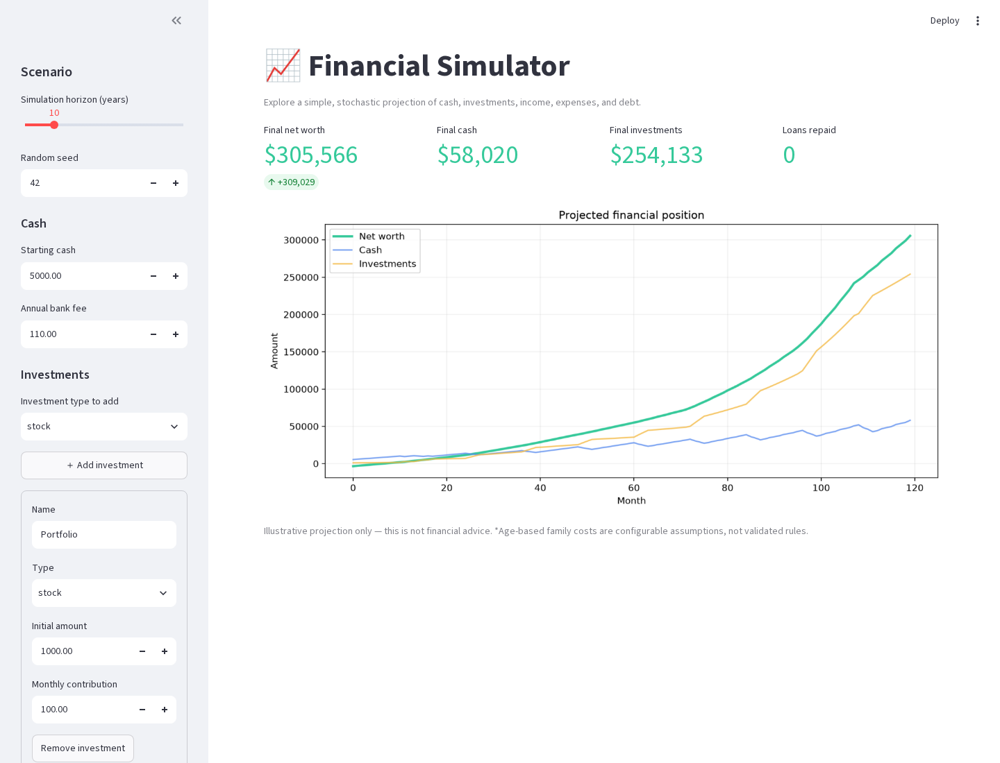
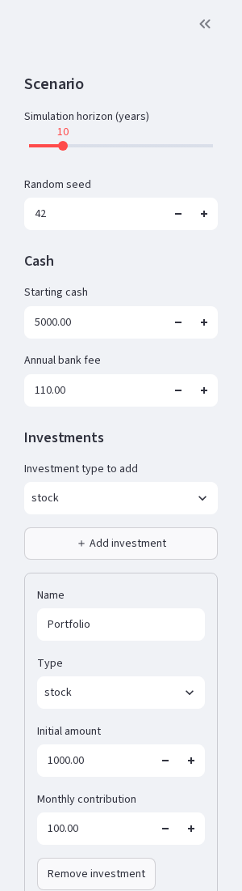

# financial_simulator
Asking ChatGPT 4 to write me a Python personal financial simulator and optimizator.

## Codex / 5.6 Luna note

This project was extended and tested with Codex (5.6 Luna). The simulator and
Streamlit interface are exploratory software: the outputs are illustrative,
the assumptions are configurable, and nothing here is financial advice.

Done for fun, personal, use, checking how many bugs ChatGPT 4 was able to introduce and I could discover/correct with him.  

Licensed as Attribution‑NonCommercial‑ShareAlike 2.0 Generic (CC BY-NC-SA 2.0).

The content and code provided in this context were produced outside of my professional work, during my personal free time, and are not affiliated with, nor influenced by, any of my current or previous employers. The materials and information shared are for illustrative purposes only and should not be construed as financial advice. Always consult with a financial professional before making any financial decisions. I do not accept any responsibility or liability for the accuracy, content, completeness, legality, or reliability of the information provided here. Use this material and any resultant outcomes at your own risk.


* Disclaimer: Not Financial Advice * 

## Optional Purchase Property workflow

The sidebar's opt-in Purchase Property section configures price, down payment,
fees, mortgage terms, ownership costs, and an exact recurring expense to stop
at closing. Automatic mode uses the first eligible month with both a cash
threshold and minimum cash retained immediately after closing; scheduled mode accepts a user-facing 1-based
month. The panel previews upfront cash, mortgage principal, and the existing
loan model's payment. Results report purchased trajectories and actual months,
or that no purchase occurred, including scheduled purchases recorded by the
engine. Imported purchase settings replace stale widget values, and a scheduled
month is clamped when the simulation horizon is shortened. Settings round-trip
through JSON; legacy exports remain disabled. Automatic mode can optionally add
an editable mortgage-affordability planning rule: selected qualifying incomes,
variable-income inclusion, total existing-plus-proposed debt service, a maximum
debt-service ratio, and adult/dependent living buffers. Annual bonuses are
excluded because they are not guaranteed, producing a more conservative estimate.
This heuristic is not a lender decision or guarantee of approval. Comparison
dashboards are not implemented. Automatic purchases can optionally use either a
fixed or seeded bounded-random delay between first eligibility and closing.

Please be advised that the content presented in the previous article, code snippets, and any related materials do not constitute financial advice. I am not a licensed financial advisor. The information and tools are provided merely as examples and should not be construed as direct, personal, or professional financial guidance.

Use at Your Own Risk:

Utilize any code, results, or information shared strictly at your own peril. While attempts have been made to provide accurate and reliable information, I disclaim all liability for any unintended errors or omissions. Furthermore, I do not assume responsibility for any outcomes or impacts, financial or otherwise, that may arise from the use of the provided data or code.

Always Consult a Professional:

Financial decision-making requires a robust understanding and careful analysis of your personal financial situation. It is imperative that any actions or decisions taken based on the information shared be thoroughly vetted and validated by professional financial consultants or advisors who can accurately assess your individual needs and circumstances.

Purpose and Limitation:

The intention behind sharing this information is purely educational and to ignite curiosity and discussion within the realm of personal finance management and technology. It is essential to approach the materials with a critical mind and to understand that real-world financial decision-making encompasses a wide array of factors that may not be encapsulated within the provided examples.

Your Finances, Your Responsibility:

Remember, your financial journey is deeply personal and uniquely tailored to your specific situation. Ensure that you navigate through your financial path with utmost caution, armed with verified information from trusted professional sources, safeguarding your economic stability now and into the future.

## Running a Simulation in Google Colab

The project can be explored directly from a fresh [Google Colab](https://colab.research.google.com/) notebook:

1. Create a new notebook.
2. Clone the repository and move into it:
   ```bash
   !git clone https://github.com/filippo-mazza/financial_simulator.git
   %cd financial_simulator
   ```
3. Import the main classes and utilities:
   ```python
   from bank_account import BankAccount
   from investment import Investment
   from loan import Loan
   from income_source import IncomeSource
   from expense import Expense
   from utils import compute_net_worth_over_time
   from plots import plot_net_worth, plot_with_confidence_intervals
   ```
4. Define your accounts, income, expenses, loans and investments (see `example.py` for a template).
5. Call `compute_net_worth_over_time` with your objects to simulate the evolution of your finances.
6. Optionally visualize the results using `plot_net_worth` or `plot_with_confidence_intervals`.

This approach lets you experiment with the simulator without installing anything locally.

## Running locally

Create a virtual environment and install the development dependencies:

```bash
python3 -m venv .venv
source .venv/bin/activate
python -m pip install -r requirements-dev.txt
python -m pytest
```

The repository's `pytest.ini` uses a project-local `.pytest-tmp` base
directory so pytest fixtures also work in environments where `/tmp` is
read-only. If a runner supplies an unusable `--basetemp`, the test
configuration falls back to this directory; writable command-line values are
still honored.

For repeatable simulations and tests, pass a seed to
`compute_net_worth_over_time(..., seed=42)`. The simulator restores the random
state after a seeded run, so it does not affect unrelated random operations.

## Streamlit UI

Run the interactive simulator locally:

```bash
make install
make run
```

The sidebar exposes the simulator's supported income, expense, investment, and
loan options. Use `make test` to run the unit and end-to-end test suite.

After a successful simulation, use **Export parameters and results** to download
a JSON record containing the complete scenario configuration and seed, summary
figures, month-by-month net worth/cash/investments, and loan repayment timing.
To revisit it later, open **Import saved scenario** in the sidebar, select that
JSON file, and choose **Import parameters**. The saved inputs are restored and
the simulation is rerun with the same seed.

### Screenshots

Choose a run count and click **Run simulations** to average multiple stochastic
projections; the random seeds are managed internally rather than exposed in the
UI. These run controls sit in the main dashboard rather than the scenario
sidebar. The sidebar categories collapse independently and keep count/amount
summaries visible in their headings for quick navigation.

Real-estate investments use **Monthly property expenses** instead of a monthly
investment contribution and also expose a **Yearly property tax**. Monthly
property costs are deducted every month; the tax is charged once in month 12 of
each simulation year. Both appear as read-only linked costs in the Expenses
category and must be edited from the corresponding investment.

Each configured real-estate investment also has an **ownership share** applied
to its full modeled market value. Only the owned value contributes to investment
totals and net worth. A property may link one existing loan and one existing
income source of type `rent` by exact name. The monthly details and JSON export
then reconcile full market value, owned value, attributable outstanding debt,
property equity, rental receipts, and linked operating costs. Links are reporting
relationships: the loan remains one global liability, rent is deposited once by
the existing income source, and costs are withdrawn once by the existing linked
expenses. Property equity is therefore informative and is not added to net worth
again. The entire linked loan balance is treated as attributable to the property;
separate fractional liability shares are not modeled. Rental income, monthly
expenses, and annual tax inputs must already represent the user's attributable
share; they are not multiplied by the ownership percentage. Legacy scenarios
default to 100% ownership with no loan or rental-income links.

Stock and safe investments can optionally enable **automatic cash-sweep
contributions**. The policy is disabled by default. For each enabled investment,
the UI configures a cash threshold, the percentage of current cash to transfer,
and a yearly transaction limit. A sweep occurs only while cumulative yearly
expenses are below 80% of cumulative net income. Enabled investments are
evaluated in their displayed order, so earlier investments can reduce the cash
available to later ones. Each transaction has the model's investment fee of up
to $50. The monthly detail table and JSON export report the gross automatic
contribution and fee separately. This is a simple legacy heuristic—not an
optimized allocation strategy, tax model, or recommendation.

Exports created before automatic contribution settings were added remain
importable. The UI warns that their automatic policies were disabled for safety
and asks the user to review each eligible investment.

Property purchases are opt-in scenario events. A purchase validates its price,
down payment, fees, mortgage terms, names, and available cash before applying
the transaction atomically. The property is added at nominal purchase price,
fees are paid as transaction costs, and any mortgage starts repayment in the
following month. Purchases can end scheduled rent and carry linked monthly
property expenses and annual tax. The automatic policy additionally requires an
available-cash threshold and separate reserve, and performs at most one
purchase per trajectory. Automatic affordability is evaluated after each
month's modeled commitments and cash sweeps. If the conditions are not met,
the trajectory continues without buying and the UI reports a warning rather
than stopping the simulation. The configured reserve is a closing-time minimum,
not a protected subaccount; later expenses, debt payments, fees, contributions,
or unforeseen costs can reduce it. Results record both the configured minimum
and actual post-closing cash. When enabled, the separate mortgage-affordability
gate uses the authoritative loan payment calculation and counts the proposed
mortgage exactly once alongside active existing loan payments. It compares that
total with selected net regular incomes using an editable variable-income
inclusion percentage, a debt-service limit, and optional household buffers.
Configured annual bonuses are never qualifying income because they are uncertain.
The assessment, assumptions, ratio, amounts, and reason are shown in results and
exported; disabling it preserves the previous cash-only rule. These are planning
assumptions, not universal lender criteria. Purchase parameters, events, fees,
and outcomes are included in simulation details and JSON exports. A completed purchase is
also marked on the interactive chart with a labeled vertical dashed line; a
deferred or no-purchase trajectory does not receive a purchase marker. In the
averaged Overview, one marker shows the rounded midpoint of the earliest/latest
purchase-month range and states the range and trajectory count; Individual run
markers show that run's exact event. The line itself uses a compact label, while
the full range and trajectory count remain available in its tooltip and summary.

An optional automatic-purchase **closing delay** separates the first eligible
month from actual completion. The delay can be a fixed number of months or an
inclusive minimum/maximum range sampled reproducibly for each trajectory. No
extra random value is consumed when this feature is disabled or the delay is
fixed. At the scheduled month, the simulator rechecks closing cash, reserve, and
any enabled mortgage-affordability rule. If they no longer pass, the selected
policy either retries monthly or cancels that trajectory's purchase. Rent keeps
running, and the property, mortgage, linked owner expenses, and chart event do
not exist until closing succeeds. Individual-run results and JSON output retain
the first eligible month, initial scheduled month, sampled delay, attempts,
latest scheduled month, status, and actual purchase month. A closing beyond the
simulation horizon is recorded as not completed rather than manufactured.

### Financial assumptions

The **Financial assumptions** sidebar section centralizes the model's illustrative
return, dividend, contribution-fee, and default income-tax inputs. These values
are saved in the JSON parameters under `assumptions`; exports that predate this
section remain readable and receive the defaults below. Explicit zero values are
preserved.

| Assumption | Default | Unit / valid range |
| --- | ---: | --- |
| Stock annual return | 8 mean, 20 volatility | percent; mean -100–100, volatility 0–100 |
| Real-estate annual return | 4 mean, 8 volatility | percent; mean -100–100, volatility 0–100 |
| Bond annual return | 2.5 mean, 5 volatility | percent; mean -100–100, volatility 0–100 |
| Safe-investment annual return | 2 mean, 1 volatility | percent; mean -100–100, volatility 0–100 |
| Stock dividend yield | 2.37 | annual percent; 0–100 |
| Investment contribution fee | $50 | currency per eligible contribution; zero or greater |
| Salary / freelance income tax | 30 | percent; 0–100 |
| Rent / royalty / other income tax | 15 | percent; 0–100 |
| Dividend income tax | 20 | percent; 0–100 |
| Pension income tax | 10 | percent; 0–100 |

Investment returns are independent annual Gaussian draws that are compounded
monthly; volatility is a standard deviation, not a guaranteed range. Draws below
−100% are floored at −100% so an investment cannot lose more than its value. Stock
dividends are paid quarterly using the configured annual yield. The contribution
fee is capped at the gross contribution and applies to stock, bond, and safe
investments. A nonzero custom tax on an individual income source overrides its
type's default tax; zero continues to mean “use the configured default” in the
current UI.

These are simplified scenario inputs, not forecasts or recommendations. The
model does not represent correlated markets, tax brackets, deductions, capital
gains tax, dividend tax inside an investment, account-specific fees, transaction
slippage, or jurisdiction-specific rules. Adjacent legacy heuristics—including
income growth, salary promotion/raise probabilities, expense inflation,
freelance variability, and the automatic cash-sweep guard—remain fixed and are
not part of this assumptions section.

### Accounting and reproducibility conventions

Each monthly snapshot is taken after income, expenses, loan payments, investment
growth and dividends, regular investment contributions, the year-end bank fee
(in months 12, 24, …), and automatic cash-sweep contributions. The tested
balance-sheet invariant is:

`ending net worth = ending cash + ending investments − ending loan balances`

Investment contributions are transfers rather than expenses: cash decreases by
the gross transfer while the investment increases by the gross amount less its
fee. Automatic contribution amounts and fees are reported separately. Income and
expense categories are monthly flows, not additional balance-sheet assets or
liabilities, so they are not added to net worth after they have affected cash.

A fixed seed and equivalent inputs produce identical complete simulation output,
including stochastic investment, freelance-income, and unexpected-expense paths.
Changing the seed, assumptions, transaction order, Python random implementation,
or model version may change the path. Reproducibility is a software property of
the configured illustrative model, not evidence that real financial outcomes are
predictable.

The dashboard combines the average summary metrics with an interactive
Vega-Lite chart. Its explicit color legends distinguish average net worth,
cash, investments, and event types. Hover for exact monthly values, or pan and
zoom to explore the projection.
Major events—including loan repayments and the configured start of school for
each dependent—appear as labeled vertical dashed lines. The standalone Python
Matplotlib helpers in `plots.py` remain available for notebook and script use.
Click any month in the interactive chart to inspect its average ending balances
and asset values—including each named investment—alongside itemized income,
expenses, loan payments, and automatic investment transactions for that month.
The detail table also shows each
income source's regular gross monthly rate, making annual inflation adjustments
and salary increases visible separately from net income received. A new run
selects the final month by default, so only one selection marker and its details
are shown initially.



The sidebar supports zero, one, or many incomes, expenses, investments, and
loans, plus configurable family members and age-based assumptions:



## Verification status

The project has been tested end to end in Codex (5.6 Luna). The current test
suite includes unit tests, collection edge cases, family scenarios, and a
subprocess smoke test that runs the documented five-year example with the real
financial model components.

```text
117 passed
```
